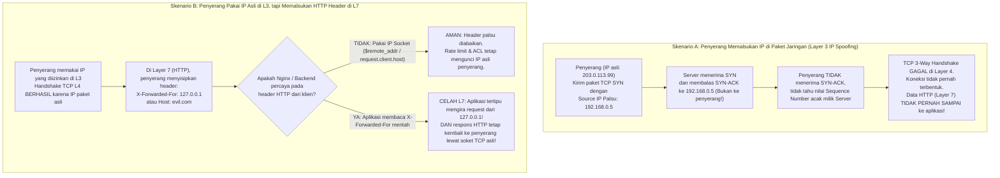

# Panduan Mandiri Keamanan Siber & Audit Kode (Berbasis Skill `security-audit`)

Dokumen ini menyarikan cara berpikir, metodologi, dan katalog serangan dari skill [`SKILL.md`](file:///d:/Work/Balai%20Teknik%20Pantai/Monitora/.agents/skills/security-audit/SKILL.md) beserta seluruh modul pendampingnya ([`ATTACK-CLASSES.md`](file:///d:/Work/Balai%20Teknik%20Pantai/Monitora/.agents/skills/security-audit/ATTACK-CLASSES.md), [`WEB-PROTOCOL-AND-AUTH.md`](file:///d:/Work/Balai%20Teknik%20Pantai/Monitora/.agents/skills/security-audit/WEB-PROTOCOL-AND-AUTH.md), [`CLIENT-SIDE.md`](file:///d:/Work/Balai%20Teknik%20Pantai/Monitora/.agents/skills/security-audit/CLIENT-SIDE.md), [`CLOUD-AND-DEPLOYMENT.md`](file:///d:/Work/Balai%20Teknik%20Pantai/Monitora/.agents/skills/security-audit/CLOUD-AND-DEPLOYMENT.md), [`DATA-ISOLATION-AND-LIFECYCLE.md`](file:///d:/Work/Balai%20Teknik%20Pantai/Monitora/.agents/skills/security-audit/DATA-ISOLATION-AND-LIFECYCLE.md), [`RESOURCE-EXHAUSTION-AND-AVAILABILITY.md`](file:///d:/Work/Balai%20Teknik%20Pantai/Monitora/.agents/skills/security-audit/RESOURCE-EXHAUSTION-AND-AVAILABILITY.md), dan [`SUPPLY-CHAIN-AND-RELEASE.md`](file:///d:/Work/Balai%20Teknik%20Pantai/Monitora/.agents/skills/security-audit/SUPPLY-CHAIN-AND-RELEASE.md)) agar Anda dapat melakukan penilaian keamanan secara mandiri dengan logika jaringan dan aplikasi yang kuat.

---

## Bab 1: Pola Pikir Audit Mandiri (Inti dari `security-audit`)

Banyak orang terjebak menilai keamanan dari **checklist permukaan** (misalnya: *"header X tidak ada"*, *"versi nginx terlihat"*). Skill `security-audit` mengajarkan prinsip utama:

> [!IMPORTANT]
> **Temuan keamanan (Vulnerability) hanya sah jika ada pelanggaran *Trust Boundary* (batas kepercayaan) yang menghasilkan dampak nyata pada pengguna lain, data rahasia, atau layanan bersama.**
> Jika hanya "kurang rapi" atau "belum mengikuti best practice" tanpa jalur serangan yang bisa melewati batas kepercayaan, itu disebut **Hardening Note** (catatan penguatan), bukan kerentanan.

### 1.1. Rumus 5 Pertanyaan *Trust Boundary*
Setiap kali Anda curiga pada sepotong kode atau konfigurasi, jawab 5 pertanyaan ini secara berurutan:

1. **Siapa *Lower-Trust Principal* (Pelaku)?**
   Apakah penyerang berasal dari internet tanpa login (*unauthenticated*), pengguna biasa yang sudah login, pengguna di LAN kantor, atau container tetangga?
2. **Input atau Aksi Apa yang Dikendalikan Pelaku?**
   Parameter URL, body JSON, HTTP header (`Host`, `X-Forwarded-For`), file unggahan, atau paket jaringan mentah?
3. **Kontrol Apa yang Seharusnya Melindungi?**
   Firewall L3/L4, autentikasi JWT, pengecekan role (`require_admin`), validasi skema Pydantic, atau sanitasi output?
4. **Batas Kepercayaan (*Trust Boundary*) Mana yang Dilanggar?**
   Apakah pelaku berhasil menyeberang dari *unauthenticated* menjadi *authenticated*? Dari *user biasa* menjadi *admin*? Dari *luar jaringan* ke *jaringan internal Docker*?
5. **Apa Dampak Konkret (*Concrete Result*) yang Terbukti?**
   Bisa membaca/mengubah data milik orang lain, mengeksekusi perintah di server (RCE), mengambil alih akun, atau mematikan layanan bersama (DoS)?

Jika salah satu dari 5 poin di atas tidak terjawab (misalnya: *"admin bisa memasukkan script untuk menyerang dirinya sendiri"* -> tidak ada batas kepercayaan yang dilanggar karena pelakunya sudah admin dan korbannya dirinya sendiri), maka itu **bukan kerentanan**.

### 1.2. Tiga Status Penilaian: `confirmed`, `needs_validation`, `rejected`
Saat Anda mengaudit kode sendiri:
- **`confirmed`**: Bukti di source code lengkap dari hulu (input) sampai hilir (sink/dampak), dan tidak ada kontrol lain di repo yang menghalanginya.
- **`needs_validation`**: Di kode terlihat berisiko, **tetapi** keamanannya bergantung pada infrastruktur di luar kode (misalnya: apakah ada Cloudflare/reverse proxy TLS di depan server? Apakah firewall kantor memblokir port 8080 dari internet?). Jangan menebak—catat sebagai hal yang harus dicek di server produksi.
- **`rejected`**: Setelah ditelusuri, ternyata sudah dihalangi oleh layer lain (misalnya oleh TCP handshake, oleh middleware, atau oleh ORM parameterization).

### 1.3. Kalibrasi Tingkat Keparahan (*Severity*)
Jangan memberi label *Critical* hanya karena terdengar seram. Gunakan patokan ini:

| Severity | Kriteria Tegas | Contoh Nyata |
|---|---|---|
| **Critical** | Penyerang **tanpa login** (*unauthenticated*) mendapat eksekusi kode (RCE), akses penuh database, atau pengambilalihan akun sembarang orang. | SQL Injection tanpa login yang membocorkan tabel `users` & `credential_profiles`. |
| **High** | Penyerang berhasil **mengalahkan kontrol keamanan eksplisit** dengan dampak besar: bypass login, baca/ubah data lintas akun/tenant, XSS tersimpan (*stored XSS*) yang menyerang admin, atau RCE setelah login. | User dengan role `viewer` bisa memanggil endpoint hapus perangkat atau membaca password terenkripsi di database. |
| **Medium** | Pelanggaran batas kepercayaan nyata tetapi **dampak terbatas** atau butuh prasyarat khusus (misal harus berada di subnet tertentu atau hanya berdampak pada sebagian kecil fitur). | CSRF pada aksi non-kritis, atau kebocoran metrik internal yang tidak memuat kredensial. |
| **Low** | Kebocoran informasi internal non-rahasia, atau serangan yang butuh usaha besar dengan hasil sangat kecil. | Perbedaan pesan error/waktu respons yang membocorkan apakah username terdaftar. |
| **Informational** | Pengamatan valid yang dampaknya sangat minimal sendirian, biasanya hanya berguna jika digabung dengan celah lain. | Header versi server terlihat (`Server: nginx/1.28`), cookie non-sensitif tanpa flag tertentu. |

### 1.4. Sepuluh Jebakan (*Anti-Patterns*) yang Harus Dihindari
1. Menganggap semua ketidaksesuaian checklist sebagai celah keamanan.
2. Memberi saran *defense-in-depth* seolah-olah aplikasi sedang bocor parah.
3. Mengetes serangan destruktif/DoS langsung ke server produksi.
4. Menebak-nebak konfigurasi firewall/proxy yang tidak tertulis di repo.
5. Menganggap aksi pengguna terhadap miliknya sendiri (*self-XSS* / *self-DoS*) sebagai celah lintas batas.
6. Membesar-besarkan error parser biasa menjadi "Remote Code Execution" tanpa bukti.
7. Mencatat temuan secara kabur tanpa menunjuk baris file dan fungsi penyebabnya.
8. Terpaku pada bug lama dan lupa mengecek fitur baru/eksperimental.
9. Memberi *severity* tinggi pada hipotesis yang masih berstatus `needs_validation`.
10. Memperbaiki di tempat yang salah (misal memfilter di frontend/UI saja, padahal API backend tetap terbuka).

---

## Bab 2: Peta Layer OSI & Logika Jaringan (Mengapa Serangan Gagal atau Berhasil di Tiap Lapis)

Memahami **Layer OSI** membuat Anda tidak mudah panik terhadap klaim serangan palsu, sekaligus tahu persis di lapis mana pertahanan harus dipasang.

### 2.1. Peta Ringkas Layer OSI dalam Keamanan Web & Infrastruktur

| Layer | Nama | Satuan Data & Identitas | Contoh Serangan Khas | Contoh Pertahanan Tepat Sasaran |
|---|---|---|---|---|
| **L2** | Data Link | Frame, **MAC Address**, VLAN tag | ARP Spoofing / Poisoning (di dalam 1 LAN yang sama), VLAN Hopping | Dynamic ARP Inspection (DAI) di switch managed, isolasi VLAN |
| **L3** | Network | Packet, **IP Address** (`src_ip`, `dst_ip`) | IP Spoofing (untuk UDP/ICMP flood), Routing manipulation, akses lintas subnet | Firewall subnet ACL (`iptables`/`nftables`), Anti-spoofing (BCP38/uRPF), Docker `internal: true` network |
| **L4** | Transport | Segment/Datagram, **Port TCP/UDP**, Sequence Number | SYN Flood, Port Scanning, Service exposure (port DB terbuka ke `0.0.0.0`) | TCP 3-Way Handshake, SYN Cookies, Port binding ke `127.0.0.1`, Nginx `allow/deny` berbasis IP socket |
| **L6** | Presentation / TLS | TLS Record, Sertifikat X.509, Cipher | Penyadapan paket (Sniffing HTTP polos), Man-in-the-Middle (MitM), sertifikat palsu | HTTPS/TLS 1.3, HSTS, mTLS, flag cookie `Secure=true` |
| **L7** | Application | HTTP Request, Header (`Host`, `Cookie`, `X-Forwarded-For`), JSON, SQL, RTSP | SQLi, XSS, CSRF, IDOR, Brute-force login, HTTP Header Spoofing, SSRF, CRLF Injection | Autentikasi (JWT/Session), Otorisasi Role, Rate Limit per akun+IP, Validasi input Pydantic, CSRF/`SameSite=Strict` |

---

### 2.2. Bedah Kasus Kunci: Mengapa Memalsukan IP di Layer 3 Berbeda Total dengan Memalsukan Header IP di Layer 7?

Pertanyaan Anda di awal sangat tepat dan merupakan fondasi cara berpikir seorang *security engineer*:
> *"Percuma merubah header yang mengandung IP karena dari Layer 3 saja sudah tidak cocok sehingga tidak akan sampai ke Layer 7; kalaupun sampai, datanya tidak akan sampai ke penyerang karena IP-nya ngasal; lalu biar lebih aman lagi Layer 7 ditambahkan metode tertentu."*

Mari kita bedah secara presisi menjadi **dua skenario berbeda** agar Anda melihat di mana letak kebenarannya dan di mana letak jebakannya:



#### Mengapa Analisis Anda Benar untuk Layer 3 & 4 (Skenario A):
1. **Tidak akan sampai ke Layer 7 (untuk protokol berbasis TCP seperti HTTP):**
   HTTP berjalan di atas TCP (Layer 4). Sebelum satu byte pun data HTTP (`GET /api/...`) diserahkan oleh kernel OS ke Nginx atau FastAPI (Layer 7), kernel harus menyelesaikan **TCP 3-Way Handshake**:
   - Penyerang mengirim `SYN` (mengaku sebagai IP `192.168.0.5`).
   - Kernel server membalas `SYN-ACK` dengan *Initial Sequence Number* (ISN) acak 32-bit ke alamat `192.168.0.5`.
   - Karena paket balasan pergi ke `192.168.0.5` (bukan ke komputer penyerang), penyerang tidak tahu angka ISN tersebut dan tidak bisa mengirim `ACK` yang valid.
   - Akibatnya, soket TCP tidak pernah berstatus `ESTABLISHED`. Aplikasi di Layer 7 **sama sekali tidak pernah dipanggil**.
2. **Kalaupun sampai (misalnya lewat protokol UDP tanpa handshake, atau penyerang menebak), datanya tidak akan kembali ke penyerang:**
   Karena tabel *routing* di Layer 3 mengirim paket balasan berdasarkan `Source IP` pada header paket L3, seluruh data balasan akan dikirim ke alamat IP palsu yang dicantumkan penyerang. Penyerang **buta** (tidak bisa membaca hasil curian datanya), kecuali penyerang sudah menyadap jalur kabel/Wi-Fi di antara server dan IP palsu tersebut (*on-path attacker*).

#### Lalu Kapan Pemalsuan Header IP Menjadi Berbahaya? (Skenario B — Jebakan Layer 7):
Penyerang yang pintar **tidak memalsukan IP di Layer 3** saat menyerang aplikasi web. Sebaliknya:
1. Dia membuka koneksi TCP normal menggunakan **IP aslinya sendiri** (sehingga L3/L4 cocok, TCP handshake sukses, dan semua balasan data dari server **pasti kembali ke dia**).
2. Begitu masuk ke Layer 7 (HTTP), dia mengirimkan teks header tambahan di dalam paket HTTP:
   ```http
   POST /api/v1/auth/login HTTP/1.1
   Host: monitora.local
   X-Forwarded-For: 10.0.0.123
   X-Real-IP: 127.0.0.1
   ```
3. **Di sinilah letak penentu buruk vs baiknya kode aplikasi:**
   - **Kode Buruk:** Developer menulis kode di backend: `client_ip = request.headers.get("X-Forwarded-For")` untuk menentukan rate-limit login atau mengizinkan akses admin. Karena header HTTP adalah teks biasa di Layer 7 yang bebas diketik siapa saja, penyerang cukup mengganti angka `X-Forwarded-For` setiap kali gagal login untuk menembus *rate limit* tanpa batas, dan balasan "Login Berhasil" tetap dikirim pulang ke penyerang melalui koneksi TCP aslinya!
   - **Kode Baik (seperti di Monitora):** Nginx mengunci akses menggunakan `$binary_remote_addr` dan `allow/deny` yang membaca langsung **IP dari soket kernel L3/L4 (`$remote_addr`)**, lalu menimpa `proxy_set_header X-Real-IP $remote_addr;`. Di sisi FastAPI ([`auth.py`](file:///d:/Work/Balai%20Teknik%20Pantai/Monitora/backend/api/routes/auth.py#L22)), backend mengambil `request.client.host` (IP soket koneksi), bukan percaya mentah-mentah pada header `X-Forwarded-For` kiriman klien.

---

### 2.3. Strategi Pertahanan Berlapis (*Defense in Depth*: L3 -> L4 -> L6 -> L7)

Mengapa kita tetap harus memasang pengaman ketat di Layer 7 walaupun Layer 3/4 sudah dibatasi subnet kantor (`allow 192.168.0.0/16`)?
Karena **ancaman bisa datang dari dalam subnet yang sudah diizinkan** (misalnya: laptop tamu yang terhubung ke Wi-Fi kantor, satu PC staf yang terkena malware, atau container yang satu jaringan).

Urutan lapis pertahanan yang ideal:
1. **Layer 3 & 4 (Jaringan & Transport):**
   - Isolasi jaringan container (`internal: true` di Docker Compose agar database Postgres dan Redis tidak punya jalur keluar/masuk dari host luar).
   - Bind port sensitif hanya ke loopback (`127.0.0.1:8001:8000`) bila hanya diakses lokal.
   - ACL subnet di gateway (`allow 192.168.0.0/16; deny all;`) yang bekerja berdasarkan IP soket L3.
2. **Layer 6 (Enkripsi Transpor / TLS):**
   - Gunakan HTTPS (TLS) agar trafik di dalam LAN/Wi-Fi kantor tidak bisa di-*sniff* (disadap) oleh pengguna lain di jaringan yang sama untuk mencuri cookie `access_token` atau password saat login.
3. **Layer 7 (Protokol HTTP & Aplikasi):**
   - **Validasi Header `Host`** (`TrustedHostMiddleware` di FastAPI) agar server menolak request dengan `Host` palsu.
   - **Rate Limiting Ganda:** di Nginx berbasis IP soket (`$binary_remote_addr`) **dan** di aplikasi berbasis kombinasi `IP + username` (agar satu akun tidak bisa di-*brute-force* ramai-ramai).
   - **Autentikasi & Otorisasi Ketat di Setiap Endpoint:** Cookie `HttpOnly`, `SameSite=Strict`, `Secure`, diverifikasi tanda tangan kriptografinya (JWT HMAC-SHA256), lalu dicek role-nya (`Depends(require_admin)`).
   - **Validasi & Sanitasi Konteks:** Skema input ketat (Pydantic) dan sanitasi saat data keluar ke protokol lain (SQL, HTML, CSV, RTSP, Prometheus metrics).

---

## Bab 3: Katalog 15 Kelas Serangan Utama (Buruk vs Baik & Alasan Teknisnya)

Setiap kelas di bawah ini disusun mengikuti disiplin skill `security-audit`: memahami di layer mana serangan bekerja, bagaimana skenarionya, perbandingan kode **BURUK** vs **BAIK**, alasan teknis mengapa yang baik menutup celah tersebut, serta cara mengetesnya sendiri secara aman di lokal.

---

### 1. Pemalsuan Identitas Proxy & Header HTTP (`X-Forwarded-For` / `Host` Trust)
- **Layer OSI:** Layer 7 (HTTP Header) yang mencoba memanipulasi asumsi identitas Layer 3 (IP) atau routing domain.
- **Ringkasan:** Aplikasi mempercayai header HTTP (`X-Forwarded-For`, `X-Real-IP`, `Forwarded`, `Host`) yang dikirim langsung oleh klien tanpa memastikan apakah header tersebut ditulis oleh reverse proxy internal yang tepercaya.
- **Skenario Serangan:**
  1. Penyerang ingin melakukan *brute-force* password admin.
  2. Aplikasi membatasi 5 percobaan gagal per IP, tetapi membaca IP dari `request.headers.get("X-Forwarded-For")`.
  3. Di setiap percobaan ke-5, penyerang mengirimkan header `X-Forwarded-For: 10.0.0.<angka_acak>`. Aplikasi mengira itu pengunjung baru dan tidak pernah memblokir penyerang.
  4. Atau penyerang mengirim `Host: phish-monitora.com` saat memicu fitur pembuatan tautan (misalnya reset password / redirect), sehingga server membuat URL yang mengarah ke domain penyerang (*Host Header Poisoning*).

#### Contoh BURUK
```python
# BURUK: Percaya langsung pada header X-Forwarded-For dan Host dari klien
@router.post("/login")
def login_buruk(payload: LoginRequest, request: Request, db: Session = Depends(get_db)):
    # Penyerang bisa mengisi X-Forwarded-For: 1.2.3.4 sesuka hati!
    client_ip = request.headers.get("X-Forwarded-For", request.client.host)
    check_rate_limit(client_ip)
    ...
```
```nginx
# BURUK di Nginx: Meneruskan X-Forwarded-For dari luar tanpa menimpa / tanpa real_ip_header yang dikunci
proxy_set_header X-Real-IP $http_x_real_ip; # Mengambil mentah dari header request klien!
```

#### Contoh BAIK (Diterapkan di Monitora)
```nginx
# BAIK di Nginx (infra/nginx/default.conf):
# 1. Rate limit memakai $binary_remote_addr (IP dari soket TCP L3/L4, tidak bisa dipalsukan via header)
limit_req_zone $binary_remote_addr zone=login_limit:10m rate=10r/m;

# 2. X-Real-IP diisi paksa dari $remote_addr (IP soket TCP), bukan dari header klien
proxy_set_header X-Real-IP $remote_addr;
```
```python
# BAIK di FastAPI (backend/main.py & backend/api/routes/auth.py):
# 1. Validasi header Host terhadap daftar allowlist
if settings.allowed_host_list and settings.allowed_host_list != ["*"]:
    app.add_middleware(TrustedHostMiddleware, allowed_hosts=settings.allowed_host_list)

# 2. Kunci rate-limit menggabungkan IP soket + username target
client_ip = request.client.host if request.client else "unknown"
user = authenticate_user(payload.username, payload.password, db, client_identifier=client_ip)
```

- **Kenapa Lebih Baik:**
  1. `$remote_addr` dan `request.client.host` diambil dari struktur data soket kernel OS (hasil TCP handshake L3/L4), bukan dari teks HTTP di L7.
  2. Kalaupun `client_ip` adalah IP container Nginx ketika lewat proxy, `authenticate_user` di [`services/auth.py`](file:///d:/Work/Balai%20Teknik%20Pantai/Monitora/backend/services/auth.py#L53-L57) menggabungkan `f"{client_identifier}:{username.strip().lower()}"`. Artinya, meskipun penyerang berganti-ganti IP atau berada di balik NAT/proxy yang sama, percobaan ke akun `admin` tetap terkunci setelah 5 kali gagal!
  3. Catatan penguatan tambahan: jika di masa depan FastAPI perlu membaca IP asli pengunjung di balik Nginx, gunakan `X-Real-IP` yang hanya diterima bila `request.client.host` berasal dari subnet container Nginx, bukan `X-Forwarded-For` mentah.
- **Cara Tes Lokal Mandiri:**
  Kirim `curl -H "X-Forwarded-For: 9.9.9.9" -H "Host: evil.local" http://localhost:8080/api/v1/auth/login`. Pastikan `Host: evil.local` ditolak dengan `400 Invalid host header` dan percobaan login ke-6 tetap terkena `429 Too Many Requests` meskipun nilai `X-Forwarded-For` diubah-ubah.

---

### 2. Injeksi Kueri & Protokol Teks (SQL Injection, CRLF Protocol Injection, Metrics Injection)
- **Layer OSI:** Layer 7 (Aplikasi — saat menyusun string perintah ke database, soket RTSP, atau format teks Prometheus).
- **Ringkasan:** Data dari pengguna digabungkan langsung (*string concatenation / f-string*) ke dalam perintah berformat teks tanpa memisahkan antara **struktur perintah** dan **nilai data**.
- **Skenario Serangan:**
  - **SQL Injection:** Input `username = "admin' --"` dimasukkan ke string SQL mentah sehingga syarat `AND password = ...` diabaikan oleh database.
  - **CRLF / Protocol Injection (RTSP/HTTP):** Input `stream_url` diberi karakter baris baru `\r\n` (`%0d%0a`) sehingga saat aplikasi merakit paket teks `OPTIONS <url> RTSP/1.0\r\n`, baris baru tersebut menyuntikkan header atau perintah RTSP kedua ke kamera/server internal.
  - **Prometheus Exposition Format Injection:** Nama perangkat diisi `"Router\npantau_device_issue{device_id=\"999\",issue=\" palsu\"} 1"`. Saat endpoint `/metrics` merender teks per baris, karakter `\n` menciptakan baris metrik palsu yang meracuni data monitoring Prometheus.

#### Contoh BURUK
```python
# BURUK 1 (SQL Injection): Menggabungkan string langsung ke SQL
query = f"SELECT * FROM users WHERE username = '{username}'"
db.execute(text(query))

# BURUK 2 (RTSP CRLF Injection): Langsung merakit URL ke soket tanpa cek \r\n dan skema
headers = [f"OPTIONS {stream_url} RTSP/1.0", "CSeq: 1"]
connection.sendall(("\r\n".join(headers) + "\r\n\r\n").encode())

# BURUK 3 (Prometheus Metric Injection): Langsung mencetak nama perangkat ke label metrik
lines.append(f'pantau_device_issue{{device_name="{device.name}"}} 1')
```

#### Contoh BAIK (Diterapkan di Monitora)
```python
# BAIK 1 (SQL Parameterization di backend/services/auth.py):
# SQLAlchemy mengirim struktur SQL dan parameter nilai secara terpisah (bound parameters)
user = db.scalar(select(User).where(User.username == username.strip()))

# BAIK 2 (Validasi Skema & Penolakan CRLF di backend/services/probes.py & schemas/device.py):
if any(char in stream_url for char in ("\r", "\n", " ", "\t")):
    return ProbeResult(False, "invalid", "URL stream tidak boleh memuat spasi atau karakter baris baru")
parsed = urlparse(stream_url)
if parsed.scheme.lower() != "rtsp" or not parsed.hostname:
    return ProbeResult(False, "invalid", "URL stream harus memakai skema rtsp:// yang valid")

# BAIK 3 (Sanitasi Baris Baru & Kutip pada Output Prometheus di backend/services/network.py):
safe_name = re.sub(r"[\r\n]+", " ", device.name).replace('"', "'").replace("\\", "")
labels = f'device_id="{device.id}",device_name="{safe_name}",issue="{code}"'
```

- **Kenapa Lebih Baik:**
  - Pada SQL, *bound parameters* membuat driver PostgreSQL memperlakukan tanda kutip `'` murni sebagai teks literal di dalam kolom, bukan sebagai penutup perintah SQL.
  - Pada RTSP dan Prometheus (yang merupakan protokol berbasis baris teks), memblokir `\r` dan `\n` di pintu masuk (Pydantic validator) **sekaligus** mensterilkannya di pintu keluar (`get_internal_metrics` dan `rtsp_probe`) menerapkan *defense-in-depth*: penyerang tidak bisa keluar dari konteks satu baris/satu nilai.
- **Cara Tes Lokal Mandiri:**
  Lihat pengujian otomatis di [`test_security_audit_fixes.py`](file:///d:/Work/Balai%20Teknik%20Pantai/Monitora/backend/tests/test_security_audit_fixes.py#L38-L90) dan [`test_security_audit_fixes.py`](file:///d:/Work/Balai%20Teknik%20Pantai/Monitora/backend/tests/test_security_audit_fixes.py#L114-L131).

---

### 3. Cross-Site Scripting (XSS) & Client-Side DOM Injection
- **Layer OSI:** Layer 7 (Browser DOM & Eksekusi JavaScript).
- **Ringkasan:** Data yang dapat dikendalikan penyerang (misalnya nama perangkat, catatan, atau parameter URL) dirender oleh browser korban sebagai kode HTML/JavaScript aktif, bukan sebagai teks biasa.
- **Skenario Serangan:**
  1. Penyerang menyimpan catatan perangkat berisi ``.
  2. Ketika Admin membuka halaman detail perangkat tersebut, jika frontend merender catatan memakai `dangerouslySetInnerHTML` atau `element.innerHTML`, script tersebut berjalan di browser Admin dengan membawa sesi login Admin!

#### Contoh BURUK
```tsx
// BURUK: Merender data dari API/user sebagai HTML mentah atau memakai URL tanpa validasi skema
export function DeviceNotesBuruk({ notes, docUrl }: { notes: string; docUrl: string }) {
  return (
    <div>
      <div dangerouslySetInnerHTML={{ __html: notes }} />
      {/* Berbahaya jika docUrl berisi "javascript:alert(document.cookie)" */}
      <a href={docUrl}>Buka Dokumentasi</a>
    </div>
  );
}
```

#### Contoh BAIK
```tsx
// BAIK: Biarkan React melakukan auto-escaping JSX ({notes}) dan validasi skema URL jika ada tautan
export function DeviceNotesBaik({ notes, docUrl }: { notes: string; docUrl: string }) {
  const isSafeUrl = /^https?:\/\//i.test(docUrl);
  return (
    <div>
      <p>{notes}</p>
      {isSafeUrl && (
        <a href={docUrl} rel="noopener noreferrer" target="_blank">
          Buka Dokumentasi
        </a>
      )}
    </div>
  );
}
```

- **Kenapa Lebih Baik:**
  - Interpolasi kurung kurawal `{notes}` di React secara otomatis mengubah `<` menjadi `&lt;` dan `>` menjadi `&gt;` di dalam teks DOM, sehingga browser tidak pernah menafsirkannya sebagai tag `<script>` atau event handler HTML.
  - Memastikan cookie sesi memakai flag `HttpOnly=True` (seperti di [`auth.py`](file:///d:/Work/Balai%20Teknik%20Pantai/Monitora/backend/api/routes/auth.py#L29)) juga menjadi lapis kedua: kalaupun terjadi XSS, JavaScript **tidak bisa membaca** nilai `document.cookie` untuk mencuri token JWT keluar!

---

### 4. Formula / CSV Injection (Penyalahgunaan Fitur Ekspor Data)
- **Layer OSI:** Layer 7 (Aplikasi Pembuat Berkas -> Aplikasi Spreadsheet di Komputer Korban).
- **Ringkasan:** Saat aplikasi mengekspor data ke CSV/Excel, sel yang diawali karakter rumus (`=`, `+`, `-`, `@`, `\t`, `\r`) akan dieksekusi sebagai formula atau perintah DDE (Dynamic Data Exchange) oleh Microsoft Excel / LibreOffice Calc ketika dibuka oleh Admin.
- **Skenario Serangan:**
  Penyerang memasukkan nama perangkat `=cmd|'/C calc'!A0` (atau formula pembaca data eksternal). Saat pejabat/admin mengunduh laporan `status.csv` dan membukanya di Excel, Excel menganggap sel tersebut sebagai rumus aktif, bukan teks nama perangkat.

#### Contoh BURUK
```python
# BURUK: Menulis langsung nilai string dari database ke CSV tanpa mengecek karakter awal
writer.writerow([device.name, device.address, device.location])
```

#### Contoh BAIK (Diterapkan di Monitora)
```python
# BAIK (backend/services/reports.py):
def _sanitize_csv_cell(value: object) -> object:
    if isinstance(value, str) and value:
        if value[0] in ("=", "+", "-", "@", "\t", "\r"):
            return f"'{value}"
    return value
```

- **Kenapa Lebih Baik:**
  Menambahkan tanda kutip tunggal `'` di depan karakter berbahaya memaksa Excel/Calc memperlakukan isi sel tersebut sebagai **teks literal**, bukan formula yang harus dihitung atau dijalankan.
- **Cara Tes Lokal Mandiri:**
  Lihat [`test_csv_report_formula_injection_sanitization`](file:///d:/Work/Balai%20Teknik%20Pantai/Monitora/backend/tests/test_security_audit_fixes.py#L93-L112).

---

### 5. Broken Access Control & IDOR (Otorisasi Layer 7 yang Terlewat)
- **Layer OSI:** Layer 7 (Logika Otorisasi Endpoint & Kepemilikan Data).
- **Ringkasan:** Aplikasi memeriksa bahwa pengguna **sudah login** (*Authentication / AuthN*), tetapi lupa memeriksa apakah pengguna tersebut **berhak** melakukan aksi tersebut atau mengakses objek dengan ID tersebut (*Authorization / AuthZ*).
- **Skenario Serangan:**
  1. Di aplikasi terdapat dua role: `viewer` (hanya boleh melihat dashboard) dan `admin` (boleh menambah/mengubah/menghapus perangkat dan melihat profil kredensial SNMP/CCTV).
  2. Di tampilan web (Next.js), tombol "Hapus Perangkat" disembunyikan untuk `viewer`.
  3. Namun jika endpoint backend `DELETE /api/v1/devices/5` hanya memasang `Depends(get_current_user)` (cukup login) dan bukan `Depends(require_admin)`, maka `viewer` cukup mengirim perintah `curl -X DELETE` langsung ke API untuk menghapus perangkat.

#### Contoh BURUK
```python
# BURUK: Hanya mengecek sudah login (get_current_user) pada endpoint mutasi/sensitif,
# mengandalkan frontend yang menyembunyikan tombol
@router.delete("/{device_id}", status_code=204)
def delete_device_buruk(
    device_id: int,
    db: Session = Depends(get_db),
    current_user: User = Depends(get_current_user), # SALAH: Viewer ikut bisa menghapus!
):
    delete_device_svc(device_id, db)
```

#### Contoh BAIK (Diterapkan di Monitora)
```python
# BAIK (backend/api/routes/devices.py & backend/api/deps.py):
def require_admin(user: User = Depends(get_current_user)) -> User:
    if user.role != UserRole.ADMIN.value:
        raise ForbiddenError("Akses administrator diperlukan")
    return user

@router.delete("/{device_id}", status_code=status.HTTP_204_NO_CONTENT)
def delete_device(
    device_id: int,
    db: Session = Depends(get_db),
    _: User = Depends(require_admin), # BENAR: Wajib role ADMIN di sisi server
) -> Response:
    delete_device_svc(device_id, db)
    return Response(status_code=status.HTTP_204_NO_CONTENT)
```

- **Kenapa Lebih Baik:**
  UI/Frontend berjalan di komputer pengguna dan **bukan batas keamanan**. Penyerang bisa memanggil API secara langsung tanpa lewat UI. Dengan mewajibkan `Depends(require_admin)` di setiap route mutasi (`POST`, `PATCH`, `DELETE`) dan route pembacaan kredensial di backend, kontrol ditegakkan di titik keputusan tepercaya terakhir (*last trusted decision point*).
- **Lapis Tambahan untuk Relasi Objek (Mencegah Cross-Object Manipulation):**
  Perhatikan juga [`update_port_expectations`](file:///d:/Work/Balai%20Teknik%20Pantai/Monitora/backend/services/network.py#L348-L350) dan [`create_manual_link`](file:///d:/Work/Balai%20Teknik%20Pantai/Monitora/backend/services/network.py#L381-L394): kode memverifikasi bahwa `port_id` yang dikirim benar-benar milik `device_id` yang sedang diedit (`if not requested.issubset(ports): raise UnprocessableEntityError(...)`). Ini mencegah IDOR lintas objek.

---

### 6. Cross-Site Request Forgery (CSRF) & Keamanan Cookie/Session
- **Layer OSI:** Layer 7 (Perilaku Browser saat mengirim Cookie otomatis lintas situs).
- **Ringkasan:** Ketika autentikasi menggunakan Cookie, browser secara default melampirkan cookie tersebut ke setiap request menuju domain tujuan, termasuk jika request itu dipicu secara diam-diam oleh tab website jahat yang sedang dibuka korban di browser yang sama.
- **Skenario Serangan:**
  1. Admin sedang login ke Monitora di tab 1.
  2. Di tab 2, Admin membuka situs jebakan di jaringan lokal/internet yang berisi form otomatis mengirim request `POST` ke alamat Monitora.
  3. Jika cookie sesi tidak memiliki proteksi `SameSite` dan endpoint menerima form-urlencoded tanpa token anti-CSRF, browser otomatis menyertakan cookie login Admin dan aksi tereksekusi.

#### Contoh BURUK
```python
# BURUK: Mengatur cookie sesi tanpa HttpOnly, tanpa SameSite=Strict/Lax
response.set_cookie(
    key="access_token",
    value=token,
    httponly=False,   # Bisa dicuri lewat document.cookie jika ada XSS
    samesite="none",  # Dikirim otomatis dari situs pihak ketiga mana pun (rawan CSRF)
)
```

#### Contoh BAIK (Diterapkan di Monitora)
```python
# BAIK (backend/api/routes/auth.py):
response.set_cookie(
    key="access_token",
    value=create_access_token(user.id),
    httponly=True,                  # Tidak bisa dibaca oleh JavaScript (melindungi dari pencurian via XSS)
    secure=settings.cookie_secure,  # Wajib True saat HTTPS aktif (melindungi dari sniffing di L6)
    samesite="strict",              # Browser TIDAK akan mengirim cookie ini jika request dipicu dari situs lain!
    max_age=settings.access_token_expire_minutes * 60,
    path="/",
)
```

- **Kenapa Lebih Baik:**
  1. `samesite="strict"` memerintahkan browser untuk **tidak pernah** melampirkan cookie `access_token` pada request lintas situs (*cross-site*).
  2. Seluruh endpoint mutasi di FastAPI menerima body berformat `application/json` (divalidasi oleh Pydantic), bukan `application/x-www-form-urlencoded` atau `text/plain`. Dalam spesifikasi browser (CORS), pengiriman `Content-Type: application/json` lintas origin bukanlah *simple request*, sehingga browser wajib melakukan *CORS preflight (`OPTIONS`)* terlebih dahulu—dan karena FastAPI tidak membuka CORS untuk origin asing, browser langsung memblokirnya sebelum request dikirim.

---

### 7. Brute Force, Rate Limiting, & Quota Accounting Bypass
- **Layer OSI:** Layer 4/7 (Nginx Connection/Request Rate Limit & Application Login Accounting).
- **Ringkasan:** Penyerang mencoba ribuan kombinasi kata sandi secara otomatis karena tidak ada pembatasan laju (*rate limit*) atau karena kunci penghitungannya bisa diakali.
- **Skenario Serangan:**
  - Jika tidak ada rate limit: penyerang menembak 1.000 password per detik.
  - Jika rate limit hanya berbasis `username` dengan cara mengunci akun permanen: penyerang sengaja menembak akun `admin` 5 kali per menit agar Admin asli terkunci terus-menerus (*Account Lockout DoS*).
  - Jika rate limit hanya berbasis huruf persis (`"Admin"` vs `"admin "`): penyerang menambah spasi atau mengubah huruf besar/kecil untuk mereset kuota.

#### Contoh BURUK
```python
# BURUK: Tidak menormalisasi username pada kunci rate limit (bisa dibypass dengan "admin ", "ADMIN", dll)
def authenticate_buruk(username: str, password: str):
    check_rate_limit(username) # "admin" != "admin "
```

#### Contoh BAIK (Diterapkan di Monitora)
```python
# BAIK (backend/services/auth.py + infra/nginx/default.conf):
# Lapis 1 di Nginx: Membatasi 10 request/menit per IP soket ($binary_remote_addr)
# Lapis 2 di Backend: Membatasi 5 kegagalan per 60 detik dengan kunci ternormalisasi:
rate_limit_key = (
    f"{client_identifier}:{username.strip().lower()}"
    if client_identifier
    else username.strip().lower()
)
check_rate_limit(rate_limit_key)
```

- **Kenapa Lebih Baik:**
  - Normalisasi `.strip().lower()` memastikan `"Admin "`, `"ADMIN"`, dan `"admin"` dihitung dalam kuota yang sama.
  - Menggabungkan `client_identifier` (IP soket) dengan `username` membuat penyerang dari satu IP yang menembak akun `admin` tidak otomatis mengunci Admin sah yang login dari komputer lain (IP berbeda).

---

### 8. Server-Side Request Forgery (SSRF) & Internal Network Probing
- **Layer OSI:** Layer 7 (Input URL/Alamat di Aplikasi) -> memicu koneksi Layer 3/4/7 dari dalam jaringan internal server.
- **Ringkasan:** Aplikasi memiliki fitur yang meminta server menghubungi alamat IP atau URL yang dimasukkan pengguna (misalnya: fitur tes koneksi, webhook, atau ambil gambar dari URL). Penyerang memasukkan alamat layanan internal (seperti `127.0.0.1`, container `db`, `prometheus:9090`, atau cloud metadata `169.254.169.254`) yang seharusnya tidak bisa diakses dari luar.
- **Skenario Serangan:**
  Jika fitur "Tes Koneksi" atau "Webhook" mengizinkan pengguna biasa (tanpa hak admin) memasukkan URL bebas `http://prometheus:9090/-/reload` atau membaca balasan HTTP mentah dari layanan internal Docker (`http://librenms:8000`), penyerang menjadikan backend sebagai jembatan (*proxy*) untuk memindai atau mengendalikan jaringan `internal`.

#### Contoh BURUK
```python
# BURUK: Endpoint tanpa otorisasi admin mengambil URL bebas dan mengembalikan seluruh isi body responsnya ke user
@router.post("/test-url")
def test_url_buruk(url: str):
    res = httpx.get(url) # Bisa diarahkan ke http://prometheus:9090 atau http://169.254.169.254!
    return {"body": res.text}
```

#### Contoh BAIK
```python
# BAIK:
# 1. Batasi fitur uji jaringan/perangkat hanya untuk Administrator (Depends(require_admin)).
# 2. Jangan pernah mengembalikan body respons mentah dari layanan yang di-probe (hanya kembalikan status boolean online/offline & latensi).
# 3. Validasi skema protokol secara ketat (misal hanya rtsp:// untuk kamera) dan blokir hostname internal/loopback jika targetnya seharusnya perangkat fisik di luar container.
import ipaddress
import socket

def is_safe_device_target(host: str) -> bool:
    # Tolak nama container internal atau loopback jika hanya boleh memantau IP perangkat LAN
    try:
        ip = ipaddress.ip_address(socket.gethostbyname(host))
        if ip.is_loopback or ip.is_link_local or ip.is_multicast:
            return False
    except OSError:
        return False
    return True
```

- **Kenapa Lebih Baik:**
  Dengan membatasi fitur probe ke admin, membatasi skema protokol, tidak memantulkan isi respons mentah (*blind response*), dan menolak alamat loopback/link-local/container internal, server tidak bisa disalahgunakan untuk mengintip layanan internal di jaringan Docker.

---

### 9. Kriptografi, Manajemen Rahasia (*Secrets*), & Kegagalan Bootstrap Production
- **Layer OSI:** Layer 7 & Penyimpanan Data (*Data at Rest*).
- **Ringkasan:** Penggunaan algoritma enkripsi yang salah (misalnya Base64 yang dikira enkripsi, AES mode ECB tanpa autentikasi, atau MD5/SHA1 untuk password), pemakaian kunci yang sama untuk dua tujuan berbeda, atau membiarkan *default password/secret key* aktif di server produksi.
- **Skenario Serangan:**
  1. Developer menaruh `APP_SECRET_KEY = "development-secret"` sebagai nilai default agar mudah saat coding.
  2. Saat di-deploy ke server produksi, admin lupa mengisi variabel `.env` tersebut.
  3. Penyerang yang tahu nilai default dari kode sumber bisa mencetak sendiri token JWT (`jwt.encode({"sub": "1"}, "development-secret")`) dan langsung masuk sebagai Admin tanpa perlu tahu password!

#### Contoh BURUK
```python
# BURUK 1: Menyimpan password perangkat dengan base64 (bukan enkripsi!) atau memakai secret default tanpa dicek saat production
def simpan_kredensial_buruk(password: str) -> str:
    return base64.b64encode(password.encode()).decode()

# BURUK 2: Membiarkan aplikasi menyala di production walaupun APP_SECRET_KEY masih nilai contoh
```

#### Contoh BAIK (Diterapkan di Monitora)
```python
# BAIK 1 (backend/core/security.py):
# - Password user di-hash dengan Argon2/recommended via pwdlib (satu arah + salt)
# - Kredensial SNMP/CCTV dienkripsi dengan AES-256-GCM + nonce acak 12 byte + Associated Data (AAD)
def encrypt_credentials(payload: dict[str, str]) -> str:
    nonce = os.urandom(12)
    raw = json.dumps(payload, separators=(",", ":")).encode("utf-8")
    encrypted = AESGCM(_credential_key()).encrypt(nonce, raw, b"pantau-credentials-v1")
    return base64.urlsafe_b64encode(nonce + encrypted).decode("ascii")

# BAIK 2 (backend/bootstrap.py): Fail-closed saat startup di production jika kunci rahasia belum diganti!
if settings.app_env == "production":
    if settings.app_secret_key == "development-secret-change-before-production":
        raise RuntimeError("APP_SECRET_KEY wajib diganti untuk production")
    if settings.credential_encryption_key == settings.app_secret_key:
        raise RuntimeError("CREDENTIAL_ENCRYPTION_KEY harus berbeda dari APP_SECRET_KEY")
    if settings.grafana_admin_password in {"", "admin", "admin12345", "replace-grafana-password"}:
        raise RuntimeError("GRAFANA_ADMIN_PASSWORD wajib diisi dan diganti untuk production")
```

- **Kenapa Lebih Baik:**
  1. **AES-256-GCM** adalah *Authenticated Encryption with Associated Data (AEAD)*: selain merahasiakan isi kredensial dengan nonce unik setiap kali disimpan, GCM mendeteksi jika ciphertext diutak-atik di database.
  2. **Key Separation:** Memaksa `CREDENTIAL_ENCRYPTION_KEY != APP_SECRET_KEY` memastikan kunci penandatangan token sesi JWT terpisah dari kunci pembuka brankas kredensial perangkat.
  3. **Fail-Closed Bootstrap:** Aplikasi menolak menyala di mode `production` bila mendeteksi password atau kunci default.

---

### 10. Keamanan JWT & Token Autentikasi (Algorithm Pinning & Status Akun)
- **Layer OSI:** Layer 7 (Manajemen Sesi & Identitas).
- **Ringkasan:** Kesalahan saat memverifikasi JSON Web Token (JWT), seperti menerima algoritma `none`, membaca algoritma dari header token tanpa dipaku (*pinned*) di server, tidak mengecek waktu kedaluwarsa (`exp`), atau tetap mengizinkan token milik akun yang sudah dinonaktifkan (`is_active = False`).
- **Skenario Serangan:**
  1. Penyerang mengubah header JWT menjadi `{"alg": "none"}` dan mengubah `"sub": "1"` tanpa tanda tangan. Jika server tidak memaku `algorithms=["HS256"]`, token palsu diterima.
  2. Atau seorang mantan pegawai yang akunnya baru saja dinonaktifkan (`is_active = False`) masih memegang cookie JWT yang masa berlakunya masih sisa 7 jam. Jika server hanya memvalidasi JWT tanpa mengecek status user di database, mantan pegawai tersebut tetap bisa mengakses sistem selama 7 jam ke depan.

#### Contoh BURUK
```python
# BURUK: Tidak memaku algoritma dan langsung percaya klaim di dalam JWT tanpa cek apakah akun masih aktif di DB
def get_user_buruk(token: str):
    payload = jwt.decode(token, options={"verify_signature": False}) # FATAL!
    return payload["sub"]
```

#### Contoh BAIK (Diterapkan di Monitora)
```python
# BAIK (backend/core/security.py & backend/api/deps.py):
ALGORITHM = "HS256"

def decode_access_token(token: str) -> int | None:
    try:
        # Algoritma dipaku secara eksplisit ke [ALGORITHM], otomatis memverifikasi signature & exp
        payload = jwt.decode(token, settings.app_secret_key, algorithms=[ALGORITHM])
        return int(payload["sub"])
    except (jwt.PyJWTError, KeyError, TypeError, ValueError):
        return None

def get_current_user(
    db: Session = Depends(get_db),
    access_token: str | None = Cookie(default=None),
) -> User:
    user_id = decode_access_token(access_token) if access_token else None
    user = db.get(User, user_id) if user_id else None
    # Mengecek keberadaan user DAN status aktif (is_active) di database pada setiap request!
    if user is None or not user.is_active:
        raise UnAuthorizedError("Sesi tidak valid")
    return user
```

- **Kenapa Lebih Baik:**
  Memaku `algorithms=["HS256"]` menutup celah *algorithm confusion*, dan memeriksa `not user.is_active` di database pada `get_current_user` memastikan pencabutan akses pegawai berdampak **detik itu juga**, tidak perlu menunggu token kedaluwarsa.

---

### 11. HTTP Framing, Reverse Proxy Subrequest (`auth_request`), & Header `Upgrade`
- **Layer OSI:** Layer 7 (Batas antara Reverse Proxy Nginx dan Upstream Service seperti Backend/Grafana).
- **Ringkasan:** Ketika aplikasi menggunakan reverse proxy (Nginx) di depan beberapa layanan (Frontend, Backend, Grafana), perbedaan cara Nginx dan layanan belakang membaca path URL, header koneksi (`Upgrade`, `Content-Length`), atau subrequest autentikasi dapat dimanfaatkan untuk melewati pemeriksaan proxy.
- **Skenario Serangan:**
  1. **Direct Internal Route Access:** Backend menyediakan endpoint `/internal/auth/session` untuk subrequest `auth_request` Nginx. Jika lokasi `/_auth/session` di Nginx lupa diberi direktif `internal;`, atau jika `/internal/...` ikut ter-proxy lewat blok `location /`, pihak luar bisa memanggil rute internal secara langsung.
  2. **Unconditional Connection Upgrade Header:** Di blok Nginx, menulis `proxy_set_header Connection "upgrade";` secara statis (bukan kondisional berdasarkan apakah klien benar-benar meminta `Upgrade: websocket`) membuat setiap request HTTP biasa dikirim ke upstream dengan header `Connection: upgrade` kosong.

#### Contoh BURUK
```nginx
# BURUK: Lupa menaruh direktif `internal;` pada lokasi subrequest auth,
# atau meneruskan semua path "/" langsung ke backend sehingga "/internal/*" bisa diakses publik
location = /_auth/session {
    proxy_pass http://backend:8000/internal/auth/session;
}
```

#### Contoh BAIK (Diterapkan di Monitora + Saran Penguatan)
```nginx
# BAIK (infra/nginx/default.conf):
# 1. Lokasi subrequest dikunci dengan `internal;` sehingga klien luar yang mengakses /_auth/session mendapat 404
# 2. Hanya prefix /api/ yang diteruskan ke backend; prefix /internal/ tidak pernah diekspos di Nginx
location = /_auth/session {
    internal;
    proxy_pass $upstream_backend/internal/auth/session;
    proxy_pass_request_body off;
    proxy_set_header Content-Length "";
    proxy_set_header Cookie $http_cookie;
}
```
```nginx
# PENGUATAN TAMBAHAN untuk WebSocket Upgrade di Nginx:
# Gunakan blok `map` di luar server {} agar Connection: upgrade hanya dikirim saat Upgrade header benar-benar ada:
map $http_upgrade $connection_upgrade {
    default upgrade;
    ''      close;
}
# Lalu di dalam location:
proxy_set_header Upgrade $http_upgrade;
proxy_set_header Connection $connection_upgrade;
```

- **Kenapa Lebih Baik:**
  Direktif `internal;` di Nginx memastikan blok tersebut hanya bisa dipanggil oleh subrequest internal Nginx (`auth_request`), tidak pernah oleh paket HTTP langsung dari luar. Selain itu, penggunaan `map $http_upgrade $connection_upgrade` menjaga header `Connection` tetap bersih untuk request HTTP biasa.

---

### 12. Business Logic Flaws & Race Conditions (TOCTOU)
- **Layer OSI:** Layer 7 (Urutan Eksekusi & Konkurensi di Aplikasi/Database).
- **Ringkasan:** Celah logika bisnis tidak menggunakan karakter aneh (tidak ada `' OR 1=1` atau `<script>`), melainkan memanfaatkan urutan langkah yang tidak dikunci secara atomik (*Time-of-Check to Time-of-Use* / TOCTOU) atau nilai angka di luar ekspektasi.
- **Skenario Serangan:**
  1. **Race Condition (Check-Then-Act tanpa Lock):** Fungsi mengecek apakah kuota masih tersedia (`if len(attempts) < 5:`), lalu mencatat percobaan di baris berikutnya tanpa `Lock` atau transaksi database. Jika penyerang mengirim 20 request secara paralel di milidetik yang sama, ke-20 thread membaca `len == 4` secara bersamaan dan semuanya lolos!
  2. **Invalid State Transition:** Menghubungkan sebuah perangkat ke dirinya sendiri (`local_device_id == remote_device_id`) hingga membuat *infinite loop* saat algoritma graf topologi menelusuri jalur jaringan.

#### Contoh BURUK
```python
# BURUK 1: Memodifikasi state bersama (shared dictionary) di memori tanpa Lock
def check_and_record_buruk(key: str):
    if len(_login_failures[key]) >= 5:
        raise TooManyRequestsError(...)
    _login_failures[key].append(time.monotonic()) # Rawan race condition antar thread!

# BURUK 2: Membuat link topologi tanpa mengecek self-loop dan tanpa BFS visited set
```

#### Contoh BAIK (Diterapkan di Monitora)
```python
# BAIK 1 (backend/services/auth.py): Menggunakan threading.Lock() saat membaca & memodifikasi state rate-limit
with _lock:
    timestamps = [t for t in _login_failures[key] if now - t < FAILURE_WINDOW_SECONDS]
    _login_failures[key] = timestamps
    if len(timestamps) >= MAX_FAILED_ATTEMPTS:
        raise TooManyRequestsError(...)

# BAIK 2 (backend/services/network.py):
# - Menolak self-link (local_device_id == remote_device_id)
# - Menggunakan dictionary `parents` sebagai visited set pada BFS `find_gateway_path_ids` agar graf siklik tidak pernah infinite loop!
if payload.local_device_id == payload.remote_device_id:
    raise UnprocessableEntityError("Koneksi harus menghubungkan dua perangkat")
```

- **Kenapa Lebih Baik:**
  Invarian bisnis ditegakkan di kode: operasi memori bersama dilindungi `Lock`, relasi graf divalidasi terhadap *self-loop*, dan algoritma penelusuran graf mencatat node yang sudah dikunjungi (`if neighbor not in parents`) sehingga siklus topologi tidak pernah membuat CPU macet (*hang*).

---

### 13. Data Lifecycle, Soft-Delete, & Stale State Leaks
- **Layer OSI:** Layer 7 (Siklus Hidup Data di Database, Cache, dan Ekspor).
- **Ringkasan:** Ketika sebuah objek dihapus secara *soft-delete* (`archived_at != None` atau `is_active = False`), jalur pembacaan utama mungkin sudah menyembunyikannya, tetapi jalur sekunder (seperti topologi, metrik internal, atau sinkronisasi background) lupa menyaring record yang sudah diarsipkan.
- **Skenario Serangan / Bug Keamanan Data:**
  Perangkat yang sudah dinonaktifkan atau diarsipkan karena sudah dipensiunkan masih ikut di-scrape oleh worker, masih membocorkan status di endpoint metrik, atau kredensial lamanya masih dipakai menghubungi IP yang kini sudah dipakai perangkat lain.

#### Contoh BURUK
```python
# BURUK: Mengambil semua Device tanpa memeriksa is_active dan archived_at
devices = list(db.scalars(select(Device)))
```

#### Contoh BAIK (Diterapkan di Monitora)
```python
# BAIK (backend/services/network.py):
# Konsisten menyaring Device.archived_at.is_(None) dan Device.is_active.is_(True)
query = select(Device).where(Device.archived_at.is_(None), Device.is_active.is_(True))
```

- **Kenapa Lebih Baik:**
  Setiap jalur kueri (topologi, sinkronisasi jaringan, eksposisi metrik internal) memeriksa kontrak siklus hidup yang sama (`is_active` dan `archived_at`), sehingga perangkat yang sudah dinonaktifkan benar-benar berhenti diproses di seluruh subsistem.

---

### 14. Resource Exhaustion & Denial of Service (DoS Aplikasi)
- **Layer OSI:** Layer 4 & Layer 7 (Batas Ukuran Body, Jumlah Item Batch, & Timeout Koneksi Eksternal).
- **Ringkasan:** Satu request dari pengguna memaksa server menghabiskan RAM, CPU, atau menahan worker thread tanpa batas waktu (*unbounded wait*), sehingga pengguna lain tidak bisa mengakses aplikasi.
- **Skenario Serangan:**
  1. **Payload Raksasa:** Penyerang mengirim JSON berukuran 500 MB untuk membuat RAM container habis (OOM Kill).
  2. **Unbounded Batch:** Endpoint `bulk-placement` dikirimkan array berisi 100.000 ID perangkat sekaligus.
  3. **Hanging Socket:** Server melakukan probe TCP/RTSP ke IP yang tidak merespons tanpa `timeout`, membuat semua worker FastAPI menggantung selamanya.

#### Contoh BURUK
```python
# BURUK: Tanpa batas ukuran list dan tanpa timeout pada koneksi jaringan keluar
class BulkUpdateBuruk(BaseModel):
    device_ids: list[int] # Bisa dikirim 1 juta item!

socket.create_connection((address, port)) # Default timeout = None (menggantung selamanya!)
```

#### Contoh BAIK (Diterapkan di Monitora)
```nginx
# BAIK 1 di Nginx (infra/nginx/default.conf):
client_max_body_size 11m;
proxy_read_timeout 30s;
```
```python
# BAIK 2 di Pydantic (backend/schemas/device.py):
class BulkPlacementUpdate(BaseModel):
    device_ids: list[int] = Field(min_length=1, max_length=100) # Dibatasi maksimal 100 item!

# BAIK 3 di Probes (backend/services/probes.py):
with socket.create_connection((address, port), timeout=3.0): # Wajib timeout eksplisit!
```

- **Kenapa Lebih Baik:**
  Setiap sumber daya memiliki batas atas (*upper bound*) yang tegas: ukuran body HTTP dibatasi di pintu depan (Nginx), panjang array dibatasi oleh Pydantic (`max_length=100`), dan setiap koneksi soket keluar memiliki `timeout` singkat (3–6 detik) agar worker tidak pernah terjebak.

---

### 15. Keamanan Container, Jaringan Docker, & Deployment Infrastructure
- **Layer OSI:** Layer 3/4 (Segmentasi Jaringan Virtual Docker) & Host Isolation.
- **Ringkasan:** Kesalahan pada konfigurasi `compose.yaml` atau Dockerfile, seperti mengekspos port database langsung ke `0.0.0.0`, menaruh semua container dalam satu jaringan flat sehingga container depan yang tertembus bisa langsung menyentuh database internal, atau memberikan hak akses host berlebih.
- **Skenario Serangan:**
  Jika `postgres` atau `redis` dipasang `ports: - "5432:5432"`, maka siapa pun di jaringan luar bisa langsung menembak database melewati Nginx dan melewati seluruh logika keamanan FastAPI!

#### Contoh BURUK
```yaml
# BURUK: Mengekspos database ke semua interface jaringan host dan tidak memisahkan network
services:
  db:
    image: postgres:17-alpine
    ports:
      - "0.0.0.0:5432:5432" # FATAL: Database terbuka langsung ke jaringan luar!
```

#### Contoh BAIK (Diterapkan di Monitora)
```yaml
# BAIK (compose.yaml):
# 1. Hanya gateway (Nginx) yang mem-publish port ke jaringan luar, dan LibreNMS admin dikunci ke 127.0.0.1:
  librenms:
    ports:
      - "127.0.0.1:${LIBRENMS_ADMIN_PORT:-8001}:8000"

# 2. Database (db, librenms-db, librenms-redis) hanya menggunakan `expose` / jaringan internal:
  db:
    networks: [internal]

# 3. Jaringan internal dan monitoring dikunci dengan `internal: true` (tidak punya akses ke/dari luar):
networks:
  edge:
  internal:
    internal: true
  monitoring:
    internal: true
  egress:
```

- **Kenapa Lebih Baik:**
  Ini adalah penerapan nyata **isolasi Layer 3/4**: container `db` tidak memiliki port yang di-publish ke host dan berada di jaringan `internal: true`. Artinya, secara arsitektur jaringan, satu-satunya cara berbicara dengan database adalah melalui kode aplikasi di dalam jaringan `internal`.

---

## Bab 4: Studi Kasus Nyata dari Codebase Monitora

Sebagai latihan membaca kode menggunakan kacamata `security-audit`, berikut adalah pemetaan langsung terhadap konfigurasi dan kode di repositori **Monitora** Anda saat ini.

### 4.1. Kontrol Keamanan yang Sudah Sangat Baik di Monitora

| Komponen & File | Baris Kode | Layer OSI | Apa yang Dilakukan & Mengapa Itu Kuat |
|---|---|---|---|
| **Gateway Subnet ACL & Socket Rate Limit**<br/>[default.conf](file:///d:/Work/Balai%20Teknik%20Pantai/Monitora/infra/nginx/default.conf#L1-L15) | `#L1-L15` | L3 / L4 / L7 | Membatasi akses hanya dari RFC1918/loopback (`allow 10.0.0.0/8`, `172.16.0.0/12`, `192.168.0.0/16`, `deny all`) dan membatasi rate login berdasarkan `$binary_remote_addr` (IP soket kernel L3, kebal terhadap pemalsuan header HTTP). |
| **Proteksi Subrequest Grafana**<br/>[default.conf](file:///d:/Work/Balai%20Teknik%20Pantai/Monitora/infra/nginx/default.conf#L64-L85) | `#L64-L85` | L7 | Walaupun Grafana menyalakan `GF_AUTH_ANONYMOUS_ENABLED: "true"` (Viewer) di [compose.yaml](file:///d:/Work/Balai%20Teknik%20Pantai/Monitora/compose.yaml#L154-L155), port Grafana tidak di-publish ke host dan blok `/grafana/` di Nginx memaksa `auth_request /_auth/session;` terlebih dahulu. |
| **Segmentasi Jaringan Docker**<br/>[compose.yaml](file:///d:/Work/Balai%20Teknik%20Pantai/Monitora/compose.yaml#L348-L355) | `#L348-L355` | L3 / L4 | Memisahkan 4 jaringan (`edge`, `internal`, `monitoring`, `egress`) dengan `internal: true` pada `internal` dan `monitoring`. |
| **Enkripsi Kredensial AES-256-GCM**<br/>[security.py](file:///d:/Work/Balai%20Teknik%20Pantai/Monitora/backend/core/security.py#L47-L59) | `#L47-L59` | L7 (Data at Rest) | Kredensial perangkat dienkripsi dengan AES-256-GCM menggunakan *nonce* acak 12 byte per enkripsi dan AAD `b"pantau-credentials-v1"`. |
| **Penjaga Startup Production**<br/>[bootstrap.py](file:///d:/Work/Balai%20Teknik%20Pantai/Monitora/backend/bootstrap.py#L129-L143) | `#L129-L143` | L7 | Menghentikan proses startup (`RuntimeError`) bila `APP_ENV=production` tetapi secret key, password admin, encryption key, atau password Grafana masih menggunakan nilai default. |
| **Anti-CRLF & Validasi Skema RTSP**<br/>[device.py](file:///d:/Work/Balai%20Teknik%20Pantai/Monitora/backend/schemas/device.py#L11-L23) & [probes.py](file:///d:/Work/Balai%20Teknik%20Pantai/Monitora/backend/services/probes.py#L56-L86) | `#L11-L23`, `#L56-L86` | L7 | Menolak karakter `\r`, `\n`, spasi, tab, skema selain `rtsp://`, dan menolak pencantuman `username:password@` di dalam URL stream. |
| **Sanitasi Formula CSV & Metrik Prometheus**<br/>[reports.py](file:///d:/Work/Balai%20Teknik%20Pantai/Monitora/backend/services/reports.py#L12-L16) & [network.py](file:///d:/Work/Balai%20Teknik%20Pantai/Monitora/backend/services/network.py#L562-L564) | `#L12-L16`, `#L562-L564` | L7 | Menambahkan prefix `'` pada sel CSV yang diawali `=`, `+`, `-`, `@`, `\t`, `\r` dan membersihkan baris baru/tanda kutip pada label metrik Prometheus. |

---

### 4.2. Catatan Penilaian Mandiri (`needs_validation` & Hardening) pada Monitora

Dalam kacamata `security-audit`, poin-poin berikut **bukan kerentanan kode yang langsung bisa dieksploitasi dari luar**, melainkan titik yang perlu Anda ketahui saat mengelola deployment produksi:

1. **Transpor HTTP Polos vs HTTPS (Layer 6 — Status: `needs_validation`):**
   - **Pengamatan:** Di [default.conf](file:///d:/Work/Balai%20Teknik%20Pantai/Monitora/infra/nginx/default.conf#L4) Nginx mendengarkan `listen 80;` (HTTP tanpa TLS), dan di [compose.yaml](file:///d:/Work/Balai%20Teknik%20Pantai/Monitora/compose.yaml#L50) variabel `COOKIE_SECURE` bernilai default `false`.
   - **Cara Menilainya Sendiri:**
     - Jika di server produksi ada *reverse proxy* TLS/HTTPS di depan container `gateway` (atau diakses lewat tunnel terenkripsi), pastikan variabel environment `COOKIE_SECURE=true` diaktifkan di `.env` produksi.
     - Jika pengguna mengakses langsung via HTTP polos (`http://192.168.x.x:8080`) melalui jaringan Wi-Fi/LAN yang tidak terisolasi, paket login dan cookie `access_token` berjalan tanpa enkripsi Layer 6 (bisa disadap dengan Wireshark/ARP spoofing di LAN yang sama). Solusi terbaik untuk deployment LAN adalah memasang sertifikat TLS (bisa menggunakan internal CA kantor atau reverse proxy HTTPS di Nginx) lalu mengaktifkan `COOKIE_SECURE=true`.
2. **IP Klien pada Rate-Limit Backend di Balik Container Nginx (Layer 7 — Catatan Arsitektur):**
   - **Pengamatan:** Di [auth.py](file:///d:/Work/Balai%20Teknik%20Pantai/Monitora/backend/api/routes/auth.py#L22), backend mengambil `client_ip = request.client.host`. Ketika trafik melewati container `gateway` (Nginx), `request.client.host` yang dilihat oleh Uvicorn/FastAPI adalah IP internal container `gateway` (misal `172.18.0.x`), bukan IP laptop pengguna.
   - **Kenapa Saat Ini Tetap Aman:**
     Karena di [services/auth.py](file:///d:/Work/Balai%20Teknik%20Pantai/Monitora/backend/services/auth.py#L53-L57) kunci rate-limit adalah `f"{client_identifier}:{username.strip().lower()}"`, dan di depan sudah ada `limit_req_zone $binary_remote_addr` milik Nginx ([default.conf](file:///d:/Work/Balai%20Teknik%20Pantai/Monitora/infra/nginx/default.conf#L1)) yang membatasi per IP laptop asli!
   - **Dampak Kecil yang Perlu Diketahui:** Jika pengguna A salah mengetik password `admin` 5 kali, maka selama 60 detik berikutnya pengguna B (dari laptop berbeda) yang mencoba login ke akun `admin` yang sama juga akan ikut tertahan 60 detik karena `client_identifier` di mata FastAPI sama-sama IP container Nginx. Jika ingin membedakan per IP laptop di sisi FastAPI, FastAPI dapat membaca `request.headers.get("X-Real-IP")` **hanya karena** Nginx di [default.conf](file:///d:/Work/Balai%20Teknik%20Pantai/Monitora/infra/nginx/default.conf#L38) sudah menimpa `X-Real-IP` dengan `$remote_addr` dan container `backend` tidak diekspos ke luar selain lewat Nginx.
3. **Hak Akses `node-exporter` ke Host (`pid: host` dan `/` mount) (Host Boundary — Catatan Operasional):**
   - **Pengamatan:** Di [compose.yaml](file:///d:/Work/Balai%20Teknik%20Pantai/Monitora/compose.yaml#L186-L192), `node-exporter` memakai `pid: host` dan me-mount `/:/rootfs:ro`.
   - **Cara Menilainya Sendiri:** Ini memang kebutuhan standar `node-exporter` untuk membaca metrik OS Linux host. Mengapa aman di desain Anda? Karena `node-exporter` hanya terhubung ke jaringan `monitoring` yang berstatus `internal: true` dan tidak mem-publish port `9100` ke host luar, serta variabel `NODE_EXPORTER_ROOTFS_MODE` default ke `ro` (read-only). Pastikan di `.env` produksi nilai `NODE_EXPORTER_ROOTFS_MODE` tidak pernah diubah menjadi `rw`.

---

## Bab 5: Checklist Penilaian Mandiri (1 Halaman untuk Review Kode & Sebelum Deploy)

Gunakan daftar periksa ini setiap kali Anda menambah fitur baru, membuat endpoint API baru, atau mengubah `compose.yaml` / `nginx`:

### A. Jaringan & Infrastruktur (Layer 3, 4, 6)
- [ ] **Port Exposure:** Apakah container baru benar-benar perlu `ports:` (terbuka ke luar host), atau cukup `expose:` di jaringan `internal`?
- [ ] **Binding Interface:** Jika port admin/debug harus di-publish ke host, apakah sudah diikat ke `127.0.0.1:PORT:PORT` alih-alih `0.0.0.0`?
- [ ] **Segmentasi Network:** Apakah database, cache (Redis), dan exporter berada di network dengan `internal: true`?
- [ ] **Enkripsi Transpor (TLS):** Di lingkungan produksi, apakah trafik login dan cookie berjalan di atas HTTPS dan `COOKIE_SECURE=true`?

### B. HTTP, Proxy, & Autentikasi (Layer 7 — Masuk)
- [ ] **Identitas IP:** Apakah fitur keamanan (ACL, rate limit, audit log) mengambil IP dari soket koneksi (`$remote_addr` / `X-Real-IP` yang ditimpa Nginx), **bukan** dari `X-Forwarded-For` mentah kiriman klien?
- [ ] **Validasi Host:** Apakah `ALLOWED_HOSTS` di produksi berisi daftar domain/IP resmi (bukan `*`)?
- [ ] **Cookie Flags:** Apakah cookie autentikasi memiliki `HttpOnly=True`, `SameSite="strict"` (atau `"lax"`), dan `Secure=True` di produksi?
- [ ] **Pencabutan Sesi & Akun:** Apakah setiap request terautentikasi memverifikasi tanda tangan token, waktu kedaluwarsa (`exp`), **dan** mengecek `user.is_active`?

### C. Otorisasi & Logika Bisnis (Layer 7 — Proses)
- [ ] **Role Check di Setiap Route:** Untuk setiap endpoint baru (`POST`, `PATCH`, `DELETE`, atau pembacaan data sensitif), apakah sudah dipasang `Depends(require_admin)` dan bukan sekadar `Depends(get_current_user)`?
- [ ] **Kepemilikan Lintas Objek (IDOR):** Jika endpoint menerima dua ID (misal `device_id` dan `port_id` atau `room_id`), apakah kode memverifikasi bahwa sub-objek tersebut benar-benar milik objek induknya?
- [ ] **Siklus Hidup Data:** Apakah kueri membaca data menyertakan filter `is_active.is_(True)` dan `archived_at.is_(None)`?
- [ ] **Batas Sumber Daya (Anti-DoS):** Apakah setiap input list/array memiliki `max_length` di Pydantic, ukuran upload dibatasi di Nginx (`client_max_body_size`), dan setiap request jaringan keluar (`httpx`/`socket`) memiliki `timeout` eksplisit?

### D. Validasi Input & Sanitasi Output (Layer 7 — Keluar)
- [ ] **Database:** Apakah seluruh kueri memakai ORM parameterisasi (SQLAlchemy `select()`/`where()`), tanpa penggabungan f-string SQL mentah?
- [ ] **Protokol Berbasis Baris (RTSP, HTTP Header, Prometheus, Log):** Apakah input string sudah menolak karakter baris baru (`\r`, `\n`)?
- [ ] **Ekspor Berkas (CSV/Excel):** Apakah sel string yang diawali `=`, `+`, `-`, `@`, `\t`, `\r` sudah disanitasi sebelum diunduh?
- [ ] **Koneksi Keluar (SSRF):** Jika server menghubungi URL/IP dari input pengguna, apakah skema protokolnya sudah dibatasi dan tidak memantulkan respons mentah dari jaringan internal?

---

## Bab 6: Glosarium Ringkas & Referensi Latihan Mandiri

### Glosarium
- **Trust Boundary (Batas Kepercayaan):** Garis pemisah antara dua area dengan tingkat wewenang berbeda (misal: antara browser pengunjung dan Nginx, antara user `viewer` dan user `admin`, atau antara network `edge` dan network `internal`).
- **Principal:** Aktor atau identitas yang melakukan aksi (bisa berupa manusia yang login, pengunjung anonim, atau proses/container).
- **Source & Sink:** *Source* adalah titik masuknya data yang dikendalikan penyerang (body JSON, query param, header HTTP); *Sink* adalah fungsi berbahaya tempat data tersebut berakhir (eksekusi SQL, pengiriman soket RTSP, render HTML DOM, penulisan file).
- **TOCTOU (*Time-of-Check to Time-of-Use*):** Celah konkurensi ketika kondisi diperiksa terlebih dahulu, tetapi sebelum aksi dijalankan, kondisinya sudah diubah oleh proses/request lain yang berjalan paralel.
- **AEAD (*Authenticated Encryption with Associated Data*):** Mode enkripsi modern (seperti AES-GCM) yang sekaligus menjamin kerahasiaan data dan keaslian/integritasnya (tidak bisa diubah diam-diam tanpa kunci).

### Sumber Belajar & Latihan Legal (Gratis)
1. **PortSwigger Web Security Academy** (`https://portswigger.net/web-security`) — Laboratorium interaktif gratis terbaik di dunia untuk mempraktikkan SQLi, XSS, CSRF, SSRF, HTTP Request Smuggling, JWT, dan Access Control di lingkungan sandbox legal.
2. **OWASP Top 10 & OWASP Cheat Sheet Series** (`https://cheatsheetseries.owasp.org/`) — Panduan ringkas standar industri untuk setiap kategori pertahanan Layer 7.
3. **RFC 9110 (HTTP Semantics) & RFC 9293 (TCP)** — Referensi utama bagaimana paket TCP Layer 4 dan pesan HTTP Layer 7 berinteraksi.
